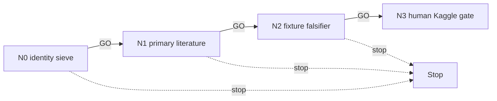

# DINOv2 — distinct mechanism DAG

The R5 XY transport, local materialization, and GPU route are terminal/no-retry. This
lane may only investigate a **new named DINO-adjacent mechanism** that is not another
packaging or rerun of those routes.

| ID | File | GO gate |
|---|---|---|
| N0 | `N0_scope.md` | mechanism differs materially from R5 XY and existing suppliers |
| N1 | `N1_literature.md` | two primary sources support its microscopy/association claim |
| N2 | `N2_falsifier.md` | fixture-only test and bounded Kaggle design are preregistered |
| N3 | `N3_human_kaggle_gate.md` | HUMAN-GATE; never launches |

## Cascade policy and standing rules

GO alone auto-advances. Read LIVE_STATE first; all other verdicts halt. Do not download
weights, materialize features, create a Kaggle asset/kernel, or touch the terminal R5
input, checkpoint, route, or its quarantined rows. Kaggle is preferred for any approved
nontrivial iteration; explicit owner approval remains mandatory. No `LEDGER.md` write.
