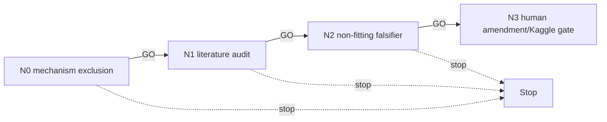

# Division — representation-conditioned selector DAG

Division fitting is locked and the current-pool diagnostic ceiling is below actionability.
This lane investigates only a **new representation-conditioned division-selector mechanism**;
it cannot fit, score, or amend the campaign automatically.

| ID | File | GO gate |
|---|---|---|
| N0 | `N0_scope.md` | candidate is not a current-pool selector/refit |
| N1 | `N1_literature.md` | two primary sources support representation-conditioned division evidence |
| N2 | `N2_falsifier.md` | non-fitting contract can distinguish it from current-pool evidence |
| N3 | `N3_human_kaggle_gate.md` | HUMAN-GATE; no plan amendment or execution |

## Cascade policy and standing rules

GO alone cascades. Read LIVE_STATE first. No division fitting, model training, held-out
scoring, 44b6/6bba/CV57 execution, graph action, tier change, or `LEDGER.md` write.
Kaggle is the preferred platform only after a human-approved amendment and protocol.
