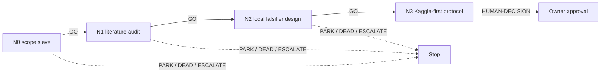

# MAIN — new-mechanism portfolio DAG

This lane searches the current PARK-A/PARK-B frontier for a non-DEAD, new named
mechanism that could move the frozen 44b6 objective. It does not reopen prior
supplier attempts, graph gates, or selector outcomes.

| ID | File | Exact GO gate |
|---|---|---|
| N0 | `N0_scope.md` | at least three eligible, distinct named mechanisms |
| N1 | `N1_literature.md` | one mechanism has two primary sources and a direct causal claim |
| N2 | `N2_falsifier.md` | a leakage-safe ≤15-min local falsifier with a preregistered kill line |
| N3 | `N3_human_kaggle_gate.md` | always stops for human decision; never launches |

## Cascade policy

Only `GO` auto-advances. PARK, DEAD, ESCALATE, and HUMAN-DECISION stop the run.
N3 is a HUMAN-GATE even if its protocol is complete.

## Standing rules

Read `reports/g02/screening/LIVE_STATE.md` first. Do not revisit any DEAD mechanism;
do not rerun terminal DINO, CELLECT, reverse, division, or node-topology routes.
No `LEDGER.md` write except by the root coordinator after a real campaign state change.
No Kaggle/RunPod launch, submission, push, asset creation, GPU debit, full cache,
graph, 6bba, or CV57 work without explicit human approval.
