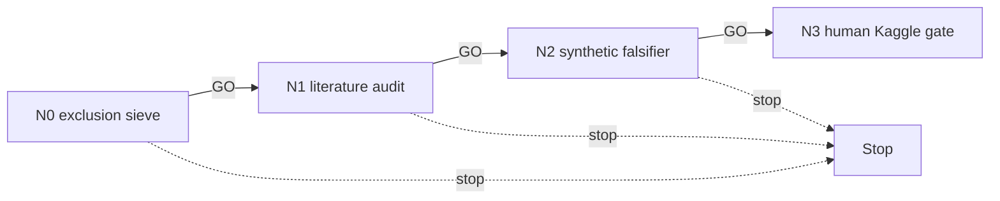

# NODETOPO — event-local alternative DAG

The raw-node-universe construction and 50-action topology-restoration graph gate are
terminal. This lane only considers a **new event-local information mechanism** that
does not rebuild that universe or retry that gate.

| ID | File | GO gate |
|---|---|---|
| N0 | `N0_scope.md` | new event-local signal avoids raw-universe/50-action replay |
| N1 | `N1_literature.md` | two primary sources ground the signal |
| N2 | `N2_falsifier.md` | synthetic contract has objective-linked kill line |
| N3 | `N3_human_kaggle_gate.md` | HUMAN-GATE; never launches |

## Cascade policy and standing rules

GO alone cascades. Read LIVE_STATE first. No raw proposal-universe rebuild, 50-action
replay, graph/44b6/6bba/CV57 score, data materialization, or `LEDGER.md` write.
Kaggle is preferred after owner approval for any nontrivial evidence run.
