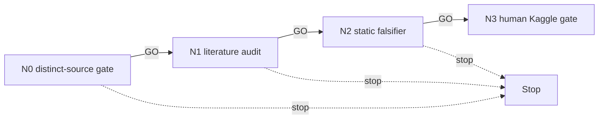

# Reverse — independent future-evidence DAG

Authentic reversed Trackastra has completed and is non-GT-identifiable, with no graph
unlock. This lane may inspect only a **new named, independently sourced future-evidence
mechanism**; it must not reproduce its model, assets, endpoint-return contract, or run.

| ID | File | GO gate |
|---|---|---|
| N0 | `N0_scope.md` | independent evidence source and distinct objective observable |
| N1 | `N1_literature.md` | two primary sources support future/causal evidence use |
| N2 | `N2_falsifier.md` | no-data static/synthetic falsifier is preregistered |
| N3 | `N3_human_kaggle_gate.md` | HUMAN-GATE; never launches |

## Cascade policy and standing rules

GO alone cascades. Read LIVE_STATE first. Do not retrieve or rerun the authenticated
Trackastra supplier, reuse its reverse cache, execute 44b6/6bba/CV57/graph work, or
write `LEDGER.md`. Kaggle is preferred only after a human approves a genuinely distinct
source and protocol; no assets, kernels, or external actions occur automatically.
