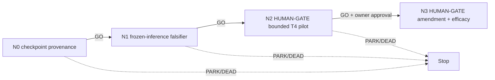

# Division checkpoint pilot — frozen external representation, one week

The owner approved a one-week pilot on a **frozen external division-representation
checkpoint** (2026-07-30). This is the only division route that avoids the fit-only
training lower bound of `5 x 8 h = 40 T4-h` established in
`../../2026-07-30-continuation/division/N3_THREE_STAGE_WEEKLY_PLAN.md`, which exceeds both
the 10–16 h weekly envelope and the 25.47 GPU-h launch capacity. A frozen external
checkpoint also removes self-supervised exposure to competition frames, which is what made
a single shared encoder transductive and illegal across the five outer folds.

Per that plan's own §"What a scientifically valid alternative looks like" item 3, this is a
**new named mechanism** — a frozen-external-representation route — not an execution repair
of `TAP-SYM-DIV`. It restarts at `N0`. As of 2026-07-30 no such checkpoint is
authenticated, so `N0` is a real gate that this lane may well fail.

Two independent locks stand between this pilot and a campaign score, and neither is
bypassed here:

1. **Division fitting is locked.** Only an owner plan amendment opens a fit-only division
   selector.
2. **`B1` reopens only after an association-continuity candidate creates scorer-valid
   local two-daughter motifs and passes full-CV57 edge-FP checks** (`B1_division_tp.md`).
   Zero qualifying arms exist. The 38 repair bundles are oracle diagnostics and are never
   a training, threshold-setting, or selection population.

Consequently the honest week-1 deliverable is `N0`+`N1`: a provenance verdict and a
frozen-inference falsifier, at **0 GPU-h**. `N2` spends the pilot's bounded GPU on
mechanism efficacy. `N3` is the only node that can produce a score, and it cannot run
without both amendments above.

| ID | File | GO gate |
|---|---|---|
| N0 | `N0_checkpoint_provenance.md` | a released checkpoint exists with pinned source/weight/license, provably no competition-frame training, and a T4-feasible inference config |
| N1 | `N1_frozen_inference_falsifier.md` | `E_syn` passes on both fixed analytic fixtures, deterministic repeat, step-0 under five seconds, 0 MiB swap |
| N2 | `N2_human_kaggle_pilot.md` | **HUMAN-GATE**; `<=8` T4-h inference-only, mechanism efficacy only |
| N3 | `N3_efficacy_gate.md` | **HUMAN-GATE**; `>=4` zero-FP division TP (`division_jaccard >= 0.08022`; local `>= 0.889544`), layered on the unchanged `+0.005` graph floors |

## Cascade policy

`GO` alone auto-advances. `PARK`/`DEAD`/`ESCALATE`/`HUMAN-DECISION` halt. `N2` and `N3`
are HUMAN-GATEs and halt for explicit owner approval **even on GO**: they may prepare a
protocol but must not create an asset, launch a kernel, debit budget, submit, or push.

## Standing rules

Inherit `../README.md` in full. Additionally:

- **Frozen means frozen.** No fine-tuning, test-time training, per-video refinement,
  adapter, or held-frame normalization. Any of these makes the route a training project
  and voids the leakage argument that justifies it.
- No held-fold frame may reach the encoder before `N3`, and then only once, one-way,
  append-only, after the selector is frozen.
- The 38 exact repair bundles stay diagnostic. They may not train, threshold, or select.
- Fold isolation is byte-exact: the existing five outer group folds and their
  `fit_f` / `held_f` manifests are unchanged and pairwise disjoint.
- Mechanism efficacy is not campaign efficacy. Time-arrow accuracy, `Q` separation, and
  apparent division counts are never substitutes for the frozen-scorer delta.
