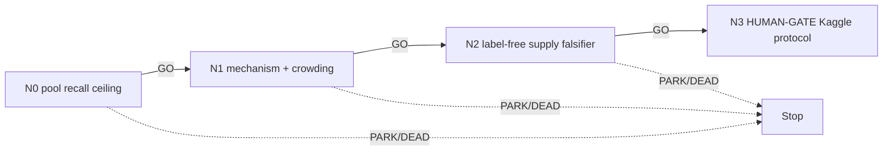

# Recall supply — can new candidate edges cover the gap that selection cannot?

**Terminal, 2026-07-30: `N0 GO -> N1 GO -> N2 DEAD`.** `NDR-FBC-local-translation-v1`
recovered `9/290 = 3.10%`, below the `20%` DEAD floor; `N3` was not entered.
`recall/runs/N0B_RECONCILIATION.md` traces *why* and extends the verdict to the
mechanism **class**: the pool-absent set is gated by the deployed action vocabulary
(both-ends-free `add`; node-disjoint single-hop `swap`), not by candidate-generation
quality, so no generator realization can clear this wall. Per
`reports/g02/screening/MARGINAL_VALUE_GATE.md`, do not fund a second generator in this
lane. Reopening requires a new named mechanism that changes the action vocabulary itself
(a compound/chained conflict-swap compiler extension), which is a distinct, separately
gated proposal against the frozen N1 compiler — not a recall/supply retry.

Banked APNCC is local `0.881522` / public `0.881`; public `0.910` maps to a planning
range of local `≈0.9255–0.9422`. The in-pool re-ranking oracle projects `~0.896`, and on
the frozen action population the **free-add and node-add oracles are exactly `0`**. Every
retained branch is therefore a selector over a candidate set that provably cannot contain
the answer. Meanwhile 44b6 held edge counts are TP/FP/FN `10,341 / 1,064 / 673`, and the
plan's own `H2` node identified `456` correct edges sitting in the 10–12 µm shell against
a `5.34M` background — i.e. a large true-edge population *outside* what the pool proposes.

This lane's Phase-1 objective is unchanged: **held-fit adjusted edge Jaccard on the frozen
scorer, 44b6 first**. Its distinct question is one the campaign has never measured
directly: of the true edges the graph is missing, how many are absent from the frozen
candidate pool entirely, and what is their zero-FP oracle ceiling? That number licenses or
kills the entire recall direction for free, before any mechanism is named.

The alpha node is **N0**, the operationalization: a deterministic partition of the held
edge FNs into pool-present and pool-absent, each with its own oracle ceiling. It also
audits the `free-add = 0` result, which is otherwise the single strongest argument that
this lane is hopeless.

| ID | File | GO gate |
|---|---|---|
| N0 | `N0_pool_recall_ceiling.md` | pool-absent true-edge set has a zero-FP oracle ceiling `>= +0.030` adjusted edge Jaccard on 44b6 |
| N1 | `N1_mechanism_and_crowding.md` | `>=1` label-free supply mechanism that is not DEAD, not a selector, grounded in `>=2` primary sources, with a named defensibility reason |
| N2 | `N2_supply_falsifier.md` | on a frozen fit-only slice, label-free generation recovers `>=50%` of the N0 pool-absent set at `<=3x` candidate-set inflation |
| N3 | `N3_human_kaggle_gate.md` | **HUMAN-GATE**; prepares a bounded 44b6-first protocol, never launches |

## Cascade policy

`GO` alone auto-advances to the next node in the same run, with no human turn. `PARK`,
`DEAD`, `ESCALATE`, and `HUMAN-DECISION` halt and report. `N3` is a HUMAN-GATE and halts
for explicit owner approval **even on GO** — it may prepare a Kaggle-first protocol but
must not create an asset, launch a kernel, debit budget, submit, push, or use RunPod.

## Standing rules

Inherit `../README.md` in full. Additionally, for this lane specifically:

- A recall mechanism must be **label-free at decision time**. GT edges may define N0's
  oracle ceiling as a diagnostic; they may never be an input to a generator, threshold,
  or selection rule.
- Supply is not selection. Any candidate that only re-ranks or re-thresholds the existing
  frozen population is out of scope here and belongs to the measured `~0.896` family.
- Recovering the shell without admitting the `5.34M` background is the whole difficulty.
  A candidate that ignores FP inflation has not addressed the problem.
- `H2`'s original enabler (frozen Trackastra features) is DEAD at the graph gate. Do not
  reinstate it; a replacement supplier must be separately named and authenticated.
