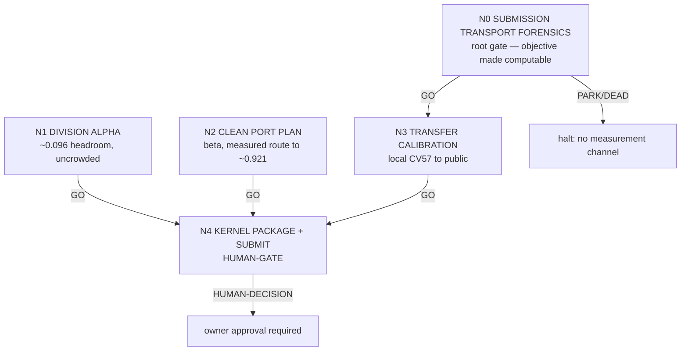

# DAG — 2026-08-06 alpha hunt (top-7 entry)

## Why this DAG exists

**seeking-alpha Phase 1 finding: our objective is not currently computable in the only
units that decide winning.** The competition is decided by the *public/private leaderboard*,
and our leaderboard score is **0.881 (rank 1111/2019)** — not the 0.914358 we hold on local
CV57. The submission that carried V32 (`55272130`, 2026-08-05 14:02) returned
`SubmissionStatus.COMPLETE` with **both publicScore and privateScore empty**. Six of our
thirteen submissions are unscored this way.

So the Phase-1 objective — "adjusted edge Jaccard + 0.1 · division Jaccard, *as measured by
Kaggle*" — has no working measurement channel. Per the skill: *"If you cannot write the
objective as something computable, that is the first subtask, not a detail to skip."*
**N0 is that subtask.** Every downstream number is uninterpretable until it returns GO.

Target for top-7 entry: **≈0.942** (live 7th = 0.933, 4th = 0.938, 1st = 0.948; snapshot
2026-08-05T19:22:39, 2,019 teams). Gap from our *verified* public 0.881 is **0.061**; gap
from local CV57 0.914358 *if it transfers* is **0.028**. Which of those two numbers is real
is exactly what N0 decides.

## Node graph

N1 and N2 are **independent of N0** and run in parallel with it — they are local-CV57 work
and need no leaderboard. Only N3 and N4 depend on N0.

## Node index

| id | file | purpose | gate to advance |
|---|---|---|---|
| N0 | `N0_SUBMISSION_TRANSPORT_FORENSICS.md` | Find the discriminating difference between our 7 scored and 6 unscored submissions; state the minimal fix | **GO** = a named root cause supported by evidence that separates *all* scored from *all* unscored refs, plus a concrete minimal fix |
| N1 | `N1_DIVISION_ALPHA.md` | Derive from the scorer why 368 forks yield 1 TP / 11 FP; find the metric asymmetry; propose grounded, locally-falsifiable division mechanisms | **GO** = ≥1 candidate passing both rigor gates (evidentiality + cheap local falsification) with a named defensibility reason |
| N2 | `N2_CLEAN_PORT_PLAN.md` | Implementation-ready port plan for the 4 absent + 2 disabled public mechanisms | **GO** = ranked port order with exact patch anchors and a zero-GPU CV57 validation per mechanism |
| N3 | `N3_TRANSFER_CALIBRATION.md` | Re-open local→public transfer once scoring works; `p0_parity.md` records fine ranking as STILL-UNRESOLVED | **GO** = a transfer relation that correctly orders two configurations differing by <0.005 locally |
| N4 | `N4_KERNEL_PACKAGE_SUBMIT.md` | **HUMAN-GATE.** Package and submit | never auto-advances |

## Cascade policy

- On **GO** → proceed directly to the next node in the same run; no human turn.
- On **PARK / DEAD / ESCALATE / HUMAN-DECISION** → halt and report.
- **N4 is a HUMAN-GATE and halts even on GO.** Auto-cascade automates *analysis*, never
  *spend* or *external effects*.

## Standing rules (inherited, not relaxed)

- Frozen official scorer only, always. Proposal-level precision does **not** predict the
  graph objective — a 0.965-precision ranker scored −0.0006 at graph level. Any intermediate
  metric is untrusted until shown to correlate.
- No Kaggle submission, GPU/RunPod, or paid-compute launch without explicit human approval
  (`CLAUDE.md`). Submissions are capped at 5/day and 2 final selections.
- Do not re-screen anything on the LIVE_STATE DEAD list / DAG §6.1 without a new named
  mechanism.
- No metric exploitation. The hub/fork division exploit is patched (host commit `aa65e90`,
  2026-07-17), rescored away, and covered by rules §3.8.d / §3.4.d. See
  `reports/g02/screening/public_solution_landscape_survey_v1.md`.
- Only the root coordinator writes `LEDGER.md`. `LIVE_STATE.md` is updated after any state
  change.
- Kaggle **read** endpoints work on the agent's own token (`.venv313/bin/kaggle`); **writes**
  go through `scripts/cmux_ops.py` in the owner's authenticated cmux session.
