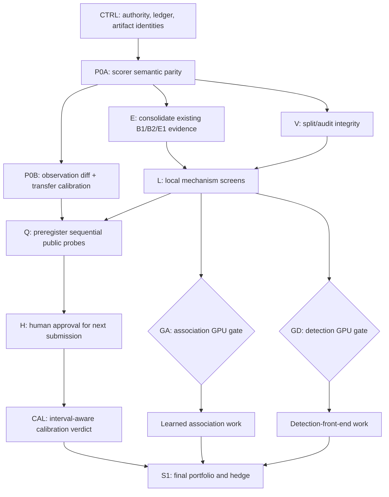

# Execution DAG — revised 2026-07-24

This DAG is the controlling screening/calibration sub-DAG for active G-02. The root
coordinator is the sole writer of `LEDGER.md`, shared gate state, and integrated
calibration artifacts. Workers own disjoint outputs and return evidence.

Scorer semantic correctness and empirical local-to-Kaggle transfer are separate gates:

- `P0A` gates every local score claim.
- `P0B/CAL` gate public-score forecasting, public-probe interpretation, and final
  selection only.
- An unresolved transfer model does **not** halt leakage-safe local decomposition,
  diagnostics, candidate development, or the association/detection GPU gates.

## Node rules

- **CTRL:** reconcile the active G-02 authority, initialize/own `LEDGER.md`, freeze
  artifact identities, and serialize shared writes.
- **P0A:** use the attested scorer and fixtures. It has already passed locally; rerun only
  when scorer/source identity changes.
- **P0B:** build canonical observation comparison and audit all existing pairs. It may
  begin from existing local predictions and the three scored public artifacts.
- **E:** consolidate and validate existing division, decomposition, fragmentation/oracle,
  and error-taxonomy evidence before rerunning anything.
- **V:** preserve grouped folds and untouched audit membership.
- **L:** run CPU/cached local mechanism screens independently of transfer calibration.
- **Q/H:** public probes are observation-distinct, preregistered, submitted one at a time,
  and count against the five-per-competition-day cap. Two final selections remain reserved.
- **CAL:** treat displayed scores as rounding intervals. Use only models identifiable from
  the accumulated pairs.
- **GA/GD:** GPU escalation depends on measured headroom, error mechanism, proxy
  improvement, runtime, and budget—not on which calibration model wins.
- **S1:** final selection waits for sufficient transfer evidence and hedges
  generalization versus family/mechanism-tagged upside.

## GPU branches

Association and detection are independent:

- `GA` requires association headroom plus a preregistered CPU/proxy improvement large
  enough to justify the planned compute.
- `GD` requires detection-bound evidence plus a corresponding front-end proxy.
- Use available private Kaggle GPU quota first.
- Every RunPod launch requires explicit human approval after logging the exact job,
  artifact identity, estimated GPU-hours, and maximum cost.

## Stop conditions

- Scorer semantic parity failure halts local scoring until repaired.
- Split/audit leakage halts affected local claims.
- Transfer calibration failure keeps public forecasting and S1 unresolved but leaves
  local development active.
- No Kaggle submission or RunPod launch occurs without explicit human approval.
- Do not exceed five Kaggle submissions per competition day or commit either final
  selection prematurely.
