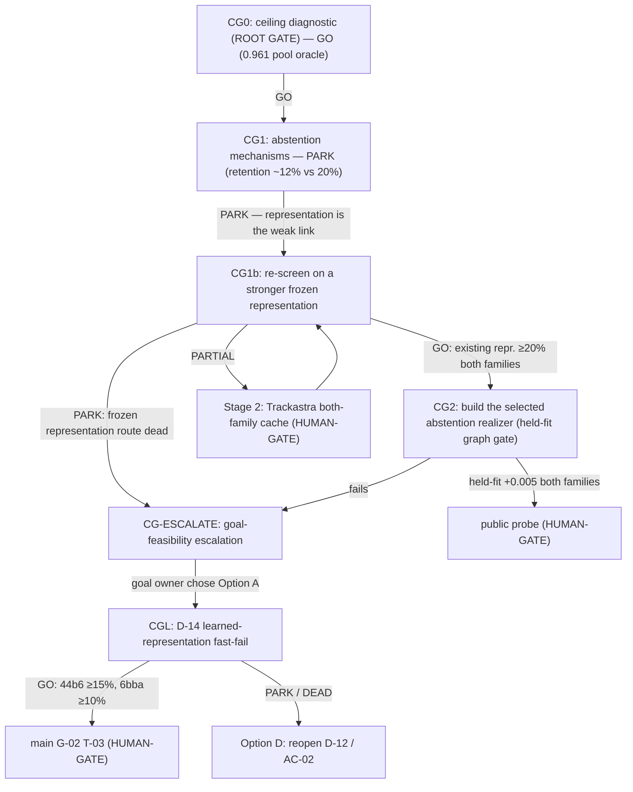

# Candidate-generation sub-DAG (candgen)

> Load `.agents/skills/seeking-alpha/SKILL.md` and `.agents/skills/dag-prompts/SKILL.md`
> first — this sub-DAG is one seeking-alpha run, wired to **auto-cascade** on GO. Also
> load `_shared_context.md`, `../DAG.md`, and `../campaign_narrowing_and_hypothesis_dag_v1.md`.
> (The folder name `candgen` is legacy — CG0 showed the frontier is *abstention*, not
> candidate generation. Kept to preserve links.)

## Why this sub-DAG exists — and what CG0 changed

The premise was that reranking was ceiling-bound (~0.896) and candidate generation was
the frontier. **CG0 overturned that.** The 0.895678 figure was a 378-swap *target
allocation*, not a true full-pool oracle. The real perfect-selection oracle over the
current r10/cap-8 pool is **0.960918 — above 0.92** (see `cg0_ceiling_diagnostic_v1`).

| Quantity | Score |
|---|---:|
| Banked (APNCC) | 0.881522 |
| **Current-pool perfect-selection oracle** | **0.960918** |
| Full-association oracle w/ correct nodes (E1) | 0.974990 |
| **Goal** | **0.920** |

So the correct edges are **already in the current pool**. The binding problem is
**selection / abstention realization**: reject **≥99.957 %** of 7.8 M unlabeled background
(admit ≤ 3,376 FP on fit117) while keeping enough of the 74 k correct edges to clear 0.92.
CG0's own directive: *target the present-but-unrankable / abstention realization inside
the current pool first; wider-radius and gap unions have harsher budgets.*

This is **not** the DEAD from-scratch ranker (LEDGER §6.1). Those died on the exact three
failure modes the realizer must solve: non-transferable per-video thresholds (IQR 0.237),
abstention against the *unlabeled* background (not GT conflicts), and 44b6 generalization.
The alpha is a mechanism that structurally solves them.

## Seeking-alpha framing

- **Phase 1 (objective):** done — CG0 made the ceiling computable and returned GO.
- **Phase 3 (alpha node):** the abstention/selection *realizer* over the current pool.
- **Phase 4 (novelty):** mine transfers the failed rankers never used — **selective
  prediction / conformal risk control** (a guaranteed FP budget *is* "admit ≤3,376"),
  **PU-learning** (the background is unlabeled-uncertain, not negative), **per-video
  calibration transfer** (a transferable statistic, not a global threshold). `CG1`.
- **Phase 5 (rigor):** falsify each against the held-fit graph objective, 44b6 first. `CG1`.
- **Phase 6 (assemble):** build only the survivor. `CG2`.

## Node graph

## Node index

| ID | File | Purpose | Gate to advance |
|----|------|---------|-----------------|
| CG0 | `CG0_ceiling_diagnostic.md` | Pool-oracle ceiling per policy | **GO** (0.961 ≥ 0.92) — done |
| CG1 | `CG1_alpha_candidate_generation.md` | Abstention mechanisms on the parked scores | **PARK** (retention ~12% vs 20%) — done |
| CG1b | `CG1b_stronger_representation_rescreen.md` | Re-screen at the FP budget on a stronger frozen representation (existing APNCC first; Trackastra only if it shows life) | retention ≥ 20% both families, certified on the full pool |
| CGL | `CGL_D14_learned_representation_fastfail.md` | Fit-only frozen-core compact-head test with a tail-aligned objective | 44b6 retention ≥15%, 6bba retention ≥10%, exact full-pool FP budgets |
| CG2 | `CG2_build_selected_proposer.md` | Build the survivor; held-fit graph gate | held-fit graph delta ≥ +0.005, both families, no recall/raw regression |
| ESC | `CG_ESCALATE_goal_feasibility.md` | Escalate if no representation realizes the ceiling | — |

## Cascade policy (dag-prompts)

- **On GO → advance to the next node in the same run**, no human turn between analysis
  nodes. CG0 GO → CG1 (**PARK**, halted the auto-cascade). Human chose the research-bet
  continuation, so **CG1b runs now**; a CG1b Stage-1 GO runs CG2.
- After CG1b PARK and CG-ESCALATE, the goal owner selected Option A. CGL now gates that
  route. A CGL GO halts at the T-03 GPU **HUMAN-GATE**; PARK/DEAD routes to Option D and
  does not launch training.
- **HUMAN-GATE (never auto-cascade):** the public probe after CG2 (Kaggle submission), any
  GPU/RunPod launch, and the `K_trackastra_6bba_feature_kernel_v1` push (CG1b Stage 2).
  These halt for explicit human approval even on GO. CG1b Stage 1 and the 44b6 CPU
  pipeline are not HUMAN-GATEs.
- On PARK / DEAD / ESCALATE / HUMAN-DECISION → halt and report.

## Standing rules (inherited, unchanged)

- Frozen scorer only; leakage-safe fit-only; no GNN; DEAD directions (§6.1) stay off.
- Only the held-fit graph delta promotes — proposal metrics report, never gate.
- Preregister every FP-budget target + kill line; record plan/research-bet/guess and the
  crowding verdict in `LEDGER.md`.
