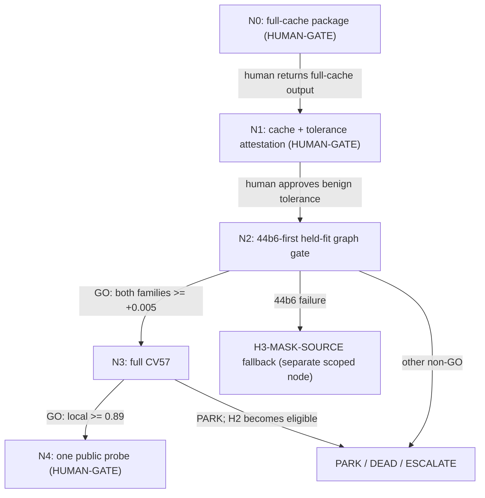

# H1 zero-wrfeat remaining cascade

> Load `../LIVE_STATE.md`, `../campaign_narrowing_and_hypothesis_dag_v1.md`,
> `../DAG.md`, `../p0_parity.md`, and
> `.agents/skills/dag-prompts/SKILL.md`. Start at the node named by
> `LIVE_STATE.md`, never from an earlier completed node.

## Why this DAG exists

The timing-only frozen Trackastra smoke passed at 5.538884 hours, but no full
fit105 feature cache or graph result exists. This DAG makes the remaining H1
falsification order dispatchable and auto-cascades analytical GO verdicts while
halting at every Kaggle, approval, or submission boundary.

## Node graph

## Node index

| ID | File | Purpose | Exact gate |
|---|---|---|---|
| N0 | `N0_full_cache_prep.md` | Pin the full-cache package | timing evidence exact, T4 repeatability PASS, projection `<=7 h` |
| N1 | `N1_cache_attest_tolerance.md` | Authenticate 105 caches and classify M5↔T4 drift | 36/69 exact coverage, no structural drift, human-approved per-column tolerance |
| N2 | `N2_held_fit_graph.md` | Execute H1's objective gate | adjusted edge Jaccard `>=+0.005` on both families, raw/node recall nonnegative |
| N3 | `N3_full_cv57.md` | Confirm the graph-passing H1 candidate | observation-distinct, local CV57 `>=0.89`, no recall regression |
| N4 | `N4_public_probe.md` | Preregister one public probe | all prior GO plus explicit human submission approval |

## Cascade policy

- **GO auto-advances only between local analytical nodes.**
- N0, N1, and N4 are **HUMAN-GATEs**. Even when their analytical checks pass,
  return `HUMAN-DECISION`, halt, and hand back exact commands or the approval
  question. Never push/version a Kaggle dataset or kernel, launch GPU/RunPod,
  or submit automatically.
- PARK / DEAD / ESCALATE / HUMAN-DECISION always halt.
- A 44b6 adjusted graph delta `<=0` kills H1 before 6bba or CV57. It makes the
  separately scoped `H3-MASK-SOURCE` provenance investigation eligible;
  pseudo-masks remain forbidden.

## Standing rules

- Read and update `../LIVE_STATE.md` on every node result. The root coordinator
  alone appends exactly one row to `../LEDGER.md`; non-root dispatches return a
  proposed row without editing it.
- Frozen scorer and frozen 27.46M Trackastra backbone only. No training or
  fine-tuning. PEFT remains conditional on a frozen 44b6 graph failure.
- No validation12/CV57/holdout access before N3. Every earlier node must fail
  closed if such a path is referenced.
- Proposal metrics may be reported but never gate. Do not re-screen any DEAD
  mechanism.
- Use the 45-second clean-idle, zero-swap preflight before local execution;
  never co-load V45 and Trackastra.
- H2 opens only after real H1 graph signal. Public submission remains after
  both family graph gates and CV57; no timing/cache notebook emits
  `submission.csv`.
