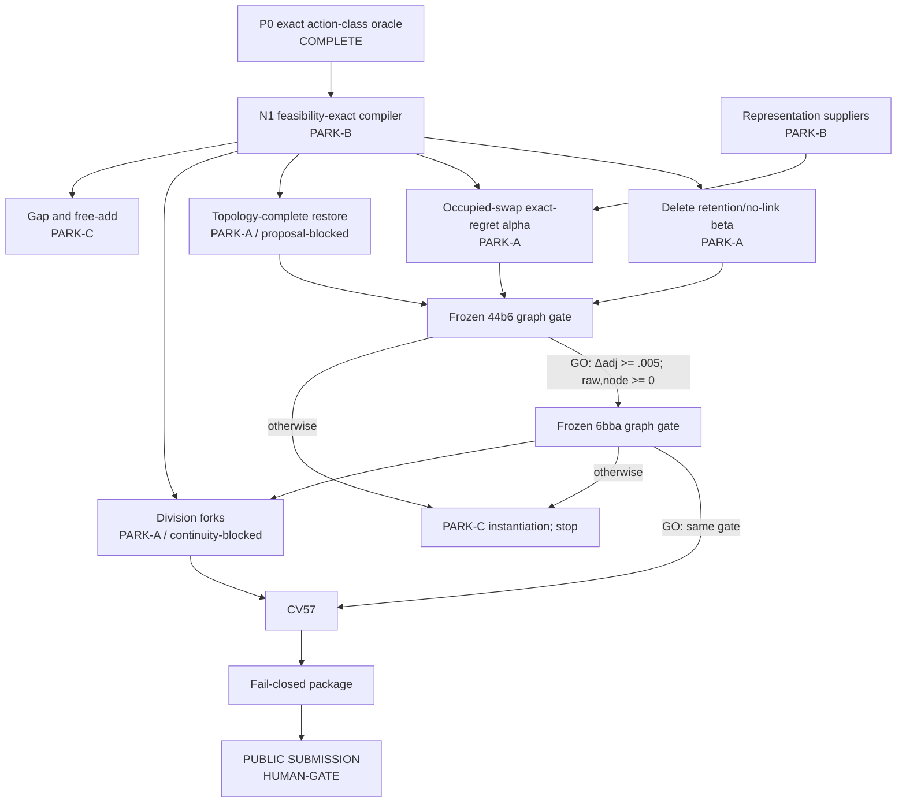

# G-02 tiered exploration DAG — P0-banked surface map

Date: 2026-07-28  
Status: **P0 COMPLETE; NO MODEL TRAINING / NO CV57 / NO EXTERNAL ACTION**

## 1. Frozen objective and evidence boundary

Optimize the exact official objective

`S(G) = weighted_adjusted_edge_Jaccard(G) + 0.1 * division_Jaccard(G)`.

Every fitted arm is frozen before outcomes open and follows
`44b6 -> 6bba -> CV57`. The normal held-fit pass line is adjusted-edge delta
`>= +0.005` on both families with raw-edge and node-recall deltas nonnegative.
Proposal precision, AUC, utility, stability, and an oracle ceiling never gate.

Only banked root artifacts set tiers. In particular:

- the supplied C2/K-best deltas are quarantined because the root record still has no
  banked C2 graph result;
- the supplied Branch-B `66/223` audit is quarantined because it has no banked root
  artifact;
- no new DEAD verdict is made here; one negative instantiation is PARK-C at most.

The human-locked campaign plan remains
`reports/g02/screening/campaign_narrowing_and_hypothesis_dag_v1.md`
at SHA-256
`a322724e77dd77f53c36e918e5345e86e8394a3848033a9a2225c21924e75116`.

## 2. P0 exact action-class oracle

The control is the exact fit117 `c=0.25` fragment set used by CG0, not the banked
APNCC incumbent. These values rank action surfaces; they are not additive forecasts
from local `0.881522`. Each action is built under official 7 µm matching, applied as
a complete graph mutation, validated, and compared per video with an explicit no-op.

| action | tier after P0 | 44b6 ΔS / Δadj / Δraw / Δnode | 6bba ΔS / Δadj / Δraw / Δnode | positive actions / raw background (44b6; 6bba) | decision |
|---|---|---:|---:|---:|---|
| add free edge | **PARK-C** | `0 / 0 / 0 / 0` | `0 / 0 / 0 / 0` | `0 / 4,022,839`; `0 / 3,780,767` | no free-endpoint headroom; do not train |
| delete edge | **PARK-A** | `+.088774 / +.081016 / +.080613 / 0` | `+.074840 / +.072067 / +.072914 / 0` | `1,334,426 / 11,071`; `1,356,863 / 60,039` | first beta lane: retention/no-link, not naive pruning |
| occupied conflict swap | **PARK-A** | `+.075828 / +.075828 / +.075448 / 0` | `+.059735 / +.059730 / +.060826 / 0` | `393 / 4,022,839`; `1,737 / 3,780,767` | first association alpha lane |
| one-gap bridge | **PARK-C** | `+.003639 / +.003639 / +.003642 / +.001180` | `+.004424 / +.004424 / +.004562 / +.001351` | `14 / 10,659,021`; `94 / 10,575,460` | positive but below `+.005` on both families |
| division fork | **PARK-A, dependency-blocked** | `+.014723 / +.001390 / +.001376 / 0` | `+.021405 / +.001271 / +.001287 / 0` | `10 / 5,159,369`; `62 / 4,568,879` | valuable event surface; fitting still locked behind association continuity |
| isolated node add | **PARK-C** | `0 / 0 / 0 / 0` | `0 / 0 / 0 / 0` | `61 / undefined`; `878 / undefined` | nodes without topology do not help |
| topology-complete node restore | **PARK-A, dependency-blocked** | `+.009812 / +.009794 / +.009766 / +.005540` | `+.024040 / +.020539 / +.021277 / +.013616` | `61 / undefined`; `878 / undefined` | real headroom, but no honest proposal/background generator exists |

`Δadj` is adjusted edge Jaccard, not the combined score. The division class is kept
PARK-A because its exact objective headroom is positive on both families; it cannot
open a standalone fitted arm. It must first inherit connected opportunities from an
association-continuity arm and then pass the normal combined graph cascade.

Exact artifacts:

- `reports/g02/screening/action_class_oracle/p0_action_class_oracle_v1.json`,
  SHA-256 `8ad548c134c419e2e76b8661848e90493d674731ceb34aab231c5c18c8889c06`;
- `reports/g02/screening/action_class_oracle/p0_action_class_oracle_v1.md`,
  SHA-256 `5ce1518f5eeb2bb929cefb81f869e7be6bf14ca8f4615c749ce41655a6cf6d39`;
- zero-swap guard,
  `reports/g02/screening/action_class_oracle/p0_action_class_oracle_guard_v1.json`,
  SHA-256 `a70b33bd7253848a1b71c8f0736f7e8b9983a1991898b19a49ee8052926f5d45`.

## 3. What P0 changes

1. **Expansion means replacement, not free addition.** All official-matching true
   r10/k8 candidates have occupied endpoints under this control. The recall shell
   must therefore enter through feasibility-exact swaps or topology restoration.
2. **Deletion is a retention problem.** The perfect action removes about 2.69 million
   edges while preserving only 71,110 true baseline edges. A conventional
   “detect the few bad edges” framing is backwards; the beta must learn conservative
   true-edge retention with explicit no-link/no-op.
3. **Swap is the highest-value association-specific surface but has an extreme
   background.** Only `393/4,023,232` 44b6 and `1,737/3,782,504` 6bba candidate
   actions are oracle-positive. Dense pretrained evidence, deployment-population
   training, PU/no-link risk, and exact abstention are more pertinent than another
   small pairwise ranker.
4. **Topology-complete restoration is the strongest genuinely new node surface.**
   Isolated node addition is null. Any detection branch must propose a node together
   with its incident topology and must first construct an honest unlabeled proposal
   universe and false-node budget.
5. **Division is high leverage but sequenced.** Ten 44b6 and 62 6bba perfect forks
   yield meaningful `ΔS`, yet B1's banked `0/51` association-restoration result still
   blocks fitting.
6. **Standalone one-gap work is deprioritized.** It is positive but below the normal
   family gate against more than ten million background pairs per family.

## 4. Branch register and tier census

The detailed node contracts, evidence paths/hashes, resume conditions, primary
sources, transfer caveats, and 44b6 kill lines are banked in:

| branch | artifact SHA-256 | P0-adjusted census |
|---|---|---:|
| association expansion | `37dd4b9a31b5b8cf420dc6744c97d5165bc29faa83cd3d7990ebdafffbc6f5be` | A 4 / B 5 / C 2 / DEAD 0 |
| event and node actions | `6df46ab0b3744a89b588d55d24e71a687f70e261667491adf6e2552c1b5fb5b3` | A 2 / B 6 / C 4 / DEAD 0 |
| representations and governance | `cdcc7214c7fe70c51a08d96a861a46920779107ad13b38dd002997ec5fb8a153` | A 4 / B 12 / C 1 / DEAD 1 |
| new atomic P0 nodes (`ADD-O0`, `DELETE-O0`, `SWAP-O0`, `NODETOPO-O0`) | P0 artifact above | A 3 / B 0 / C 1 / DEAD 0 |

Operational branch-node census (branch-scoped entries; shared mechanisms are
intentionally counted in each owning branch):

| LIVE | PARK-A | PARK-B | PARK-C | DEAD |
|---:|---:|---:|---:|---:|
| **0** | **13** | **23** | **8** | **1** |

P0 overrides the pre-outcome inventories only as follows:

- `AE-P4` and `GAP-O0`: PARK-A -> PARK-C (weak, below `+.005`);
- `DIV-O0`: PARK-B -> PARK-A, but fitting remains dependency-blocked;
- `NODEADD-O0`: PARK-B -> PARK-C (exactly null);
- `ADD-O0`: new PARK-C;
- `DELETE-O0`, `SWAP-O0`, and theoretical topology-complete `NODETOPO-O0`:
  new PARK-A.

The banked-candidate-specific `NODERESTORE-O0` stays PARK-B: P0 used exact GT node
restoration and did not establish an authentic candidate generator.

## 5. Tiered dependency DAG

## 6. Funding order

1. **N1 compiler:** freeze a reusable action schema; validate endpoints, all incident
   conflicts, temporal direction, degrees, no merges/dangling endpoints, single
   actions, and combined batches before support freezes.
2. **Near-term beta:** conservative delete/retain plus current-policy occupied swaps,
   exact no-op, and frozen-scorer regret. This is the shortest route to local
   `~0.895-0.900`; it must still pass 44b6 first.
3. **Association alpha portfolio:** compare, under the identical compiler and action
   population, bidirectional-cycle evidence, phase/template tracklet evidence,
   microscopy-specific dense embeddings, environment-robust training, and
   frozen-backbone 44b6 PEFT. These are PARK-B until their cheap identity/support
   falsifiers run.
4. **Topology restoration alpha:** only after an authentic raw-image node proposal
   universe and deterministic harmful-node stress curve exist.
5. **Division:** only after an association-continuity pass. The oracle result does
   not amend the locked plan.

Kaggle GPU is authorized up to 30 h/week and is preferred for heavy representation
generation. Every run must bank cumulative hours before the next starts. RunPod is
forbidden. Public submission always stops for explicit human approval.

