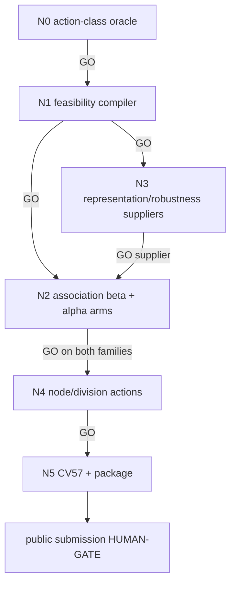

# Tiered surface execution cascade

This dispatchable DAG turns the P0 surface map into a cheapest-first experimental
cascade. It optimizes the frozen official graph score and never lets a proxy metric
advance a node.

| id | file | purpose | exact advance gate |
|---|---|---|---|
| N0 | `N0_ACTION_ORACLE.md` | measure class headroom before models | at least one class has positive exact headroom; invalid actions = 0 |
| N1 | `N1_FEASIBILITY_COMPILER.md` | make actions graph-valid before support freezes | 100% unit, single-action, and batch validity |
| N2 | `N2_ASSOCIATION_REALIZERS.md` | screen delete/swap beta and differentiating association evidence | 44b6 then 6bba: Δadjusted >= +.005, raw/node >= 0 |
| N3 | `N3_REPRESENTATION_ROBUSTNESS.md` | authenticate and cheaply falsify representation suppliers | provenance + deterministic support gain before graph spend |
| N4 | `N4_EVENT_NODE_ACTIONS.md` | open node restoration and division only after dependencies | same family gates; division additionally needs continuity |
| N5 | `N5_CV57_PACKAGE_HUMAN_GATE.md` | CV57 and fail-closed package | package GO stops at human submission gate |

## Cascade policy

- GO advances immediately to the listed child in the same run.
- PARK, DEAD, ESCALATE, or HUMAN-DECISION halts that branch.
- Parallel N2/N3 work is allowed after N1.
- No agent except the root coordinator edits `LEDGER.md`; node outputs include a
  proposed ledger row.
- Kaggle GPU is allowed within the banked 30 h/week cumulative budget.
- RunPod is forbidden. Public submission is always a HUMAN-GATE.
- Local execution requires the 45-second idle preflight and zero swap growth.

