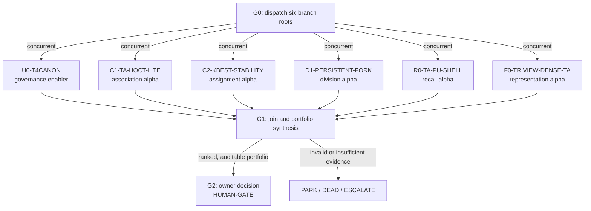

# Top-50 six-branch parallel DAG

> Load `../LIVE_STATE.md`, `../campaign_narrowing_and_hypothesis_dag_v1.md`,
> `../top50_seeking_alpha_research_20260727.md`, `SHARED_CONTRACT.md`,
> `.agents/skills/seeking-alpha/SKILL.md`, and
> `.agents/skills/dag-prompts/SKILL.md`. Branches start from their own `DAG.md`.

## Why this DAG exists

APNCC is public `0.881`, while the user-supplied top-50 bar is `>=0.910` and maps
coarsely to local `0.9255–0.9422`. The current-pool edge-only ceiling is about
`0.896`, so one crowded reranker cannot plausibly close the gap. This DAG launches
six independent foundation/research lanes concurrently, forces each to cite its
mechanism and expose a cheap graph-level falsifier, and prevents parallelism from
bypassing scientific dependencies or permission gates.

## Node graph

Concurrency applies to branch roots and all dependency-safe foundation work.
It does **not** imply simultaneous gate execution: `C1/C2` wait for U0's locked
contract, `D1/R0` wait for a both-family association pass, and `F0` stops before GPU.

## Node index

| ID | File | Purpose | Exact gate |
|---|---|---|---|
| G0 | `G0_dispatch_six.md` | Start six owned branch roots in parallel | six dispatch records, disjoint ownership, shared contract acknowledged |
| G1 | `G1_join_and_synthesize.md` | Reconcile terminal artifacts without winner's-curse selection | all six return valid verdicts/evidence classes; no missing negative |
| G2 | `G2_owner_decision.md` | Present the smallest justified execution portfolio | HUMAN-GATE; no automatic compute/CV57/submission |

## Branch index

| Lane | Branch DAG | Role | Execution dependency |
|---|---|---|---|
| U0 | `branches/u0_t4canon/DAG.md` | New governance enabler; beta control path | human lock; old N1 stays DEAD |
| C1 | `branches/c1_ta_hoct_lite/DAG.md` | Main compact association alpha | locked U0 |
| C2 | `branches/c2_kbest_stability/DAG.md` | Assignment-stability alpha | locked U0 |
| D1 | `branches/d1_persistent_fork/DAG.md` | Main division/scorer alpha | association pass on both families |
| R0 | `branches/r0_ta_pu_shell/DAG.md` | Learned no-link recall alpha | pretrained association signal |
| F0 | `branches/f0_triview_dense_ta/DAG.md` | Dense representation reserve alpha | Wave 1+2 ceiling case; GPU approval |

## Cascade policy

- G0 dispatches all six roots concurrently and proceeds to G1 only after all six
  have a terminal artifact. Available worker-slot limits may queue work, but must not
  change ownership, branch contracts, or the six-way join.
- Inside a branch, **GO** auto-advances only as its `DAG.md` permits.
- PARK / DEAD / ESCALATE / HUMAN-DECISION halt that branch. A halted branch still
  contributes its negative evidence to G1; it is not silently dropped.
- Any HUMAN-GATE halts even if the analytical threshold passes. G2 never cascades
  into GPU, submission, RunPod, push, or external mutation.

## Standing rules

- `SHARED_CONTRACT.md` is binding across all six lanes.
- Frozen scorer, observation-distinct splits, and 44b6-first graph falsification.
- Proposal metrics are diagnostics only. Do not use CV57 for model selection.
- Do not re-screen DEAD mechanisms without a new name and material mechanism.
- Only the root coordinator writes `../LEDGER.md`; branch workers propose rows.
- Update `../LIVE_STATE.md` after an actual node result, gate flip, DEAD promotion,
  or owner decision—not for mere speculative prose.
