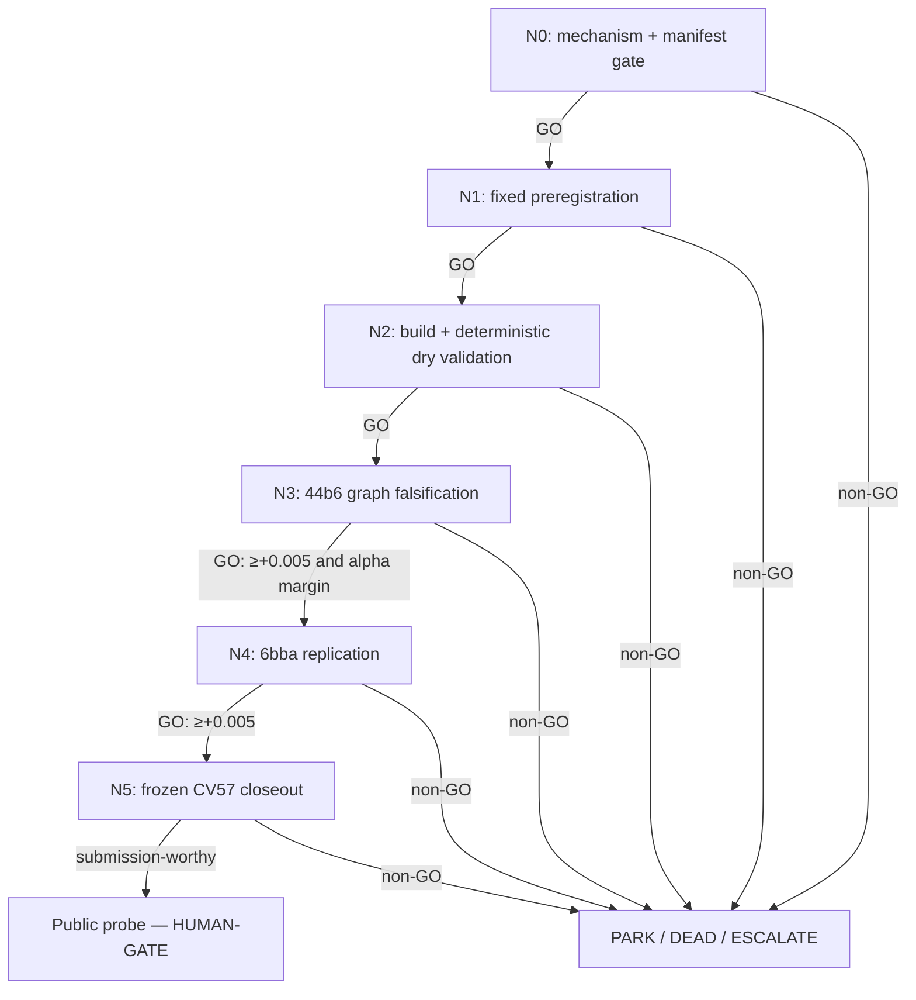

# C1-TA-HOCT-LITE — frozen conflict-set attention DAG

> Load `.agents/skills/seeking-alpha/SKILL.md`,
> `.agents/skills/dag-prompts/SKILL.md`, `../../../LIVE_STATE.md`,
> `../../../top50_seeking_alpha_research_20260727.md`, and
> `../../../campaign_narrowing_and_hypothesis_dag_v1.md` before dispatch.

## Why this DAG exists

The computable objective is the frozen official graph score, screened first on the
36 fit-only 44b6 videos. C1 tests one fixed `<=100,000`-parameter, permutation-aware
edge-set attention head over frozen Trackastra/APNCC conflict rows, with an explicit
no-link token and no graph-topology message passing. It must improve adjusted edge
Jaccard by `>=+0.005` on **each** family, keep raw edge Jaccard and node recall
nonnegative, and beat the frozen Trackastra linear-head control `C0-T4TA-LINEAR` by
`>=+0.001` on 44b6 to earn an **alpha** claim.

Trackastra itself and a linear head are necessary **beta**: many competent teams will
use the obvious pretrained tracker. C1's crowding defense is the less-obvious
distillation of HOCT's edge-interaction mechanism into a tiny set model on the
already-authenticated cache. It addresses the campaign-specific failure in which good
pairwise proposal rankings collapse after mutually competing edges enter the graph.

Primary basis: [Trackastra, ECCV 2024](https://www.ecva.net/papers/eccv_2024/papers_ECCV/papers/09819.pdf)
and [Higher-Order Cell Tracking Transformer, arXiv:2607.11754](https://arxiv.org/abs/2607.11754)
(2026 preprint; mechanism evidence, not a benchmark guarantee).

## Node graph

## Node index

| ID | File | Purpose | Exact advance gate |
|---|---|---|---|
| N0 | `N0_mechanism_manifest.md` | Prove novelty, cache identity, and legal data boundary | all evidence/identity/disqualifier checks pass |
| N1 | `N1_fixed_preregistration.md` | Freeze one architecture, folds, controls, null, and scorer contract | complete immutable preregistration, `<=100k` parameters |
| N2 | `N2_build_dry_validate.md` | Implement without opening held graph outcomes | deterministic tests, fold isolation, exact control replay |
| N3 | `N3_44b6_graph_falsification.md` | Cheapest valid alpha kill | adjusted `>=+0.005`; raw/node `>=0`; `>=+0.001` over C0 |
| N4 | `N4_6bba_replication.md` | Reject a 44b6-only curiosity | adjusted `>=+0.005`; raw/node `>=0` |
| N5 | `N5_cv57_closeout.md` | Freeze once, score CV57, then stop at public boundary | observation-distinct, adjusted `>=+0.005`; raw/node `>=0` |

## Cascade policy

- Dispatch N0. A **GO** proceeds directly to the next node in the same run.
- PARK / DEAD / ESCALATE / HUMAN-DECISION halt immediately and report.
- N3 is always 44b6-first. Never open 6bba after a 44b6 non-GO.
- N5 may perform local frozen CV57 only after both family gates pass. Any Kaggle
  submission, Kaggle GPU, RunPod, paid compute, push, or outward-facing mutation is a
  **HUMAN-GATE** and never auto-cascades.
- This folder is a preregistered foundation. Merely creating it authorizes no run.

## Standing rules

- Fit-only inputs until N5; validation/test/CV57 identities cannot affect fitting,
  architecture, thresholds, fold choice, or arm selection.
- Proposal precision/AUC/support are diagnostics only. Only exact frozen-scorer graph
  deltas promote.
- Frozen Trackastra body; one compact head; no GNN, topology message passing, adaptive
  architecture search, threshold sweep, hand-tuned graph cost, or scalar-only repair.
- Compare against exact APNCC and the fixed C0 beta on identical folds and fragments.
- Each node writes a report plus a **proposed** LEDGER row and updates
  `../../../LIVE_STATE.md` after an actual result or gate change. Only the root
  coordinator may edit `../../../LEDGER.md`.
