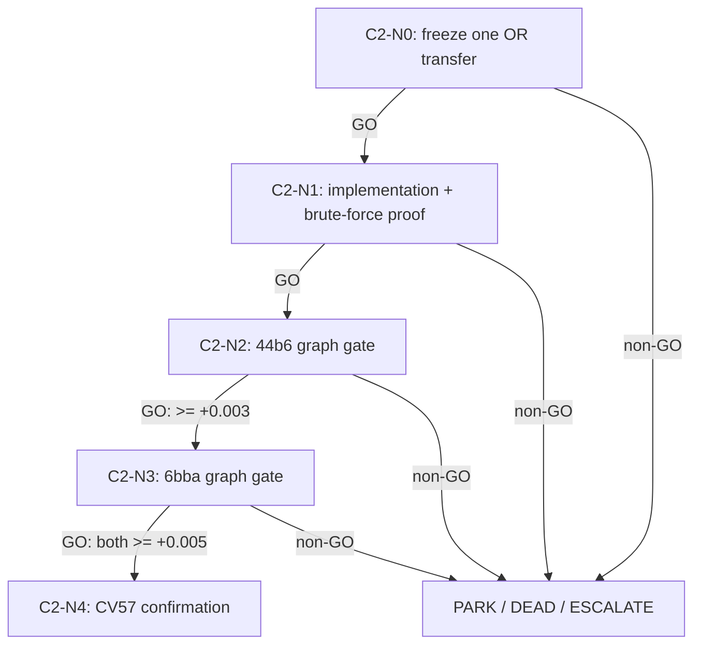

# C2-KBEST-STABILITY — assignment-sensitivity cascade

> Load `../../../LIVE_STATE.md`,
> `../../../campaign_narrowing_and_hypothesis_dag_v1.md`,
> `../../../top50_seeking_alpha_research_20260727.md`,
> `.agents/skills/seeking-alpha/SKILL.md`, and
> `.agents/skills/dag-prompts/SKILL.md`. Execution requires a human-locked
> `U0-T4CANON` contract and frozen C0 cost source.

## Why this DAG exists

Pairwise confidence is not the graph decision: one-to-one competition couples edges.
C2 transfers ranked-assignment sensitivity from operations research. It changes no
cost coefficient; it enumerates the eight lowest-cost feasible component assignments
and keeps a Trackastra-supported change only when its assignment membership and exact
min-marginal are stable, otherwise falling back to APNCC. The computable objective is
frozen-scorer adjusted edge Jaccard, 44b6 first.

## Node graph

## Node index

| ID | File | Purpose | Exact advance gate |
|---|---|---|---|
| C2-N0 | `N0_freeze_transfer.md` | Pin one K/rule and controls before labels | `K=8`, exact min-marginal rule, no sweep, U0/C0 hashes fixed |
| C2-N1 | `N1_implement_verify.md` | Prove enumeration/cost invariance cheaply | brute-force equivalence on all fixtures; deterministic replay |
| C2-N2 | `N2_graph_44b6.md` | Hardest-family objective falsification | adjusted `>=+0.003`, raw/node `>=0`, distinct |
| C2-N3 | `N3_graph_6bba.md` | Test cross-family transfer | both families `>=+0.005` for standalone GO |
| C2-N4 | `N4_cv57.md` | One frozen full-CV confirmation | adjusted delta `>=+0.005`, raw/node `>=0`, distinct |

## Cascade policy and standing rules

- GO auto-advances; all other verdicts halt. If U0 is not owner-locked, PARK without
  implementation or scoring. No node edits `../../../LEDGER.md`; return a proposed row.
- N2 is 44b6-first. At `<=0`, DEAD before 6bba. A reproducible `+0.003..+0.005`
  both-family result is PARKed as stack evidence, not sent to CV57.
- Proposal metrics are diagnostics only. No held labels select K, costs, frequency,
  min-marginal sign, fallback, or arm. No adaptive search and no graph-cost sweep.
- No Kaggle/RunPod/GPU/submission action. CV57 opens only after both family `>=+0.005`.
- Primary grounding: Murty's ranked assignment algorithm
  ([Operations Research 1968](https://doi.org/10.1287/opre.16.3.682)) and Lawler's
  general K-best partitioning procedure
  ([Management Science 1972](https://doi.org/10.1287/mnsc.18.7.401)).
  Frozen Trackastra features follow
  [Gallusser & Weigert, ECCV 2024](https://www.ecva.net/papers/eccv_2024/papers_ECCV/papers/09819.pdf).
- **Beta controls:** APNCC and the same-cost C0 MAP assignment. **Alpha:** uncertainty
  is defined over feasible assignments, not independent edges. Few teams are likely
  to transfer OR sensitivity analysis onto the authenticated competition cache.

