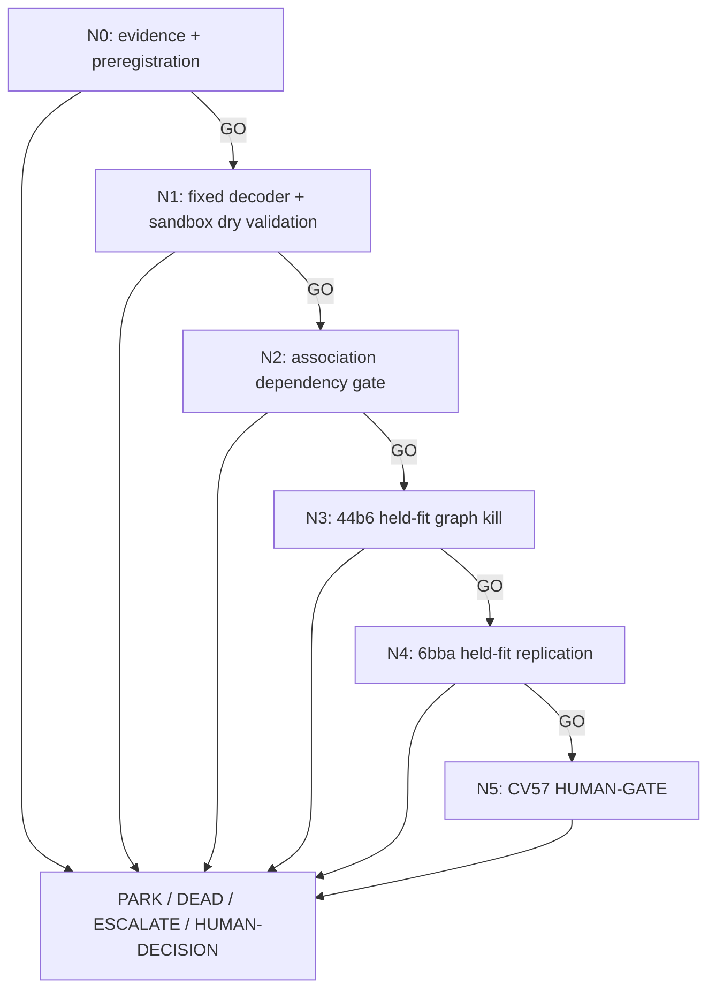

# D1-PERSISTENT-FORK — scorer-semantic division DAG

> Load `../../SHARED_CONTRACT.md`, `../../../LIVE_STATE.md`,
> `../../../top50_seeking_alpha_research_20260727.md`,
> `.agents/skills/seeking-alpha/SKILL.md`, and
> `.agents/skills/dag-prompts/SKILL.md` before dispatching a node.

## Why this DAG exists

CV57 contains 42 GT divisions and the current graph earns zero division credit.
The official scorer rewards a connected parent-to-two-branch motif, including a
one-frame-late fork whose children/grandchildren support distinct daughter lineages,
and penalizes duplicate forks. D1 tests one fixed compact decoder over **frozen
pretrained Trackastra features**. The ordinary Trackastra parental-softmax/greedy fork
decode is the necessary beta control; the scorer-semantic late/persistent motif with
one-to-one event suppression is the alpha. Design and dry validation may run now, but
held-fit graph execution is locked until an association arm passes both families.

## Evidence and novelty boundary

- Trackastra supplies pretrained, division-aware association probabilities and
  one-parent/two-child constraints; its parental softmax reduced division errors in
  the published ablation:
  <https://www.ecva.net/papers/eccv_2024/papers_ECCV/papers/09819.pdf>.
- The executable competition scorer is the primary specification for local fork,
  daughter/grandchild, and one-to-one pairing semantics:
  <https://github.com/royerlab/kaggle-cell-tracking-competition/blob/075fc5f5a52d11077f9dc2b074644618f26939e2/src/tracking_cellmot/division_metrics.py>.
- Local sandbox replay establishes the exact late-fork and duplicate behavior under
  this scorer: `../../../../division_sandbox_and_holdout_decomposition_v1.md`.

These sources do **not** validate D1's exact decoder. D1 is a grounded, locally
falsifiable research bet. Its defensible alpha is the competition-specific synthesis:
score the scorer's equivalence class rather than exact-time mitosis, require branch
persistence, and suppress equivalent forks before graph emission.

## Node graph

## Node index

| ID | File | Purpose | Exact GO gate |
|---|---|---|---|
| N0 | `N0_metric_hypothesis.md` | Freeze the scorer-derived causal hypothesis and controls | complete hypothesis card; fixed D0/D1 arms and thresholds; source claims traceable |
| N1 | `N1_build_sandbox_validate.md` | Implement/dry-check without held graph outcomes | scorer fixtures reproduced; 0 duplicate survivors; deterministic and leakage-safe |
| N2 | `N2_association_dependency.md` | Enforce the causal prerequisite | one association arm has `>=+0.005` adjusted delta on 44b6 and 6bba, raw/node nonnegative, plus increased connected fork opportunities |
| N3 | `N3_44b6_graph_kill.md` | Cheapest objective-level falsifier | division Jaccard `>=0.30`; adjusted/raw/node deltas nonnegative; no duplicate fork |
| N4 | `N4_6bba_replication.md` | Replicate across the second family | same absolute gate; D1 alpha attribution also survives fixed D0 comparison |
| N5 | `N5_cv57_human_gate.md` | Request confirmatory CV57 authority | always HUMAN-DECISION until separate approval |

## Cascade policy

GO auto-advances. PARK, DEAD, ESCALATE, or HUMAN-DECISION halts. N2 may not infer
its dependency from proposal diagnostics. N5 is a HUMAN-GATE and never runs CV57
without a separate explicit approval. No node may launch GPU, Kaggle, RunPod, a
submission, or an external mutation.

## Standing rules

- Four fixed arms only: graph unchanged, D0 beta, D1 alpha, D1 with persistence
  ablated. The held result may not select a new architecture or threshold.
- Five observation-distinct grouped fit folds; no edge-row or lineage leakage.
- Required graph vector:
  `adjusted edge delta, raw edge delta, node-recall delta, division TP/FP/FN/Jaccard,
  combined-score delta, emitted/suppressed duplicate forks`.
- Minimum D1 survival is division Jaccard `>=0.30`; `<=0.15` is DEAD for this named
  mechanism; `(0.15, 0.30)` is PARK. Any negative adjusted/raw/node delta or retained
  duplicate fork is DEAD.
- Division Jaccard `>=0.50` is a stretch diagnostic, not a rewritten promotion gate.
- Proposal, motif, and calibration metrics are diagnostics only.
- Branch workers propose LEDGER rows in reports; only the root edits `LEDGER.md`.

