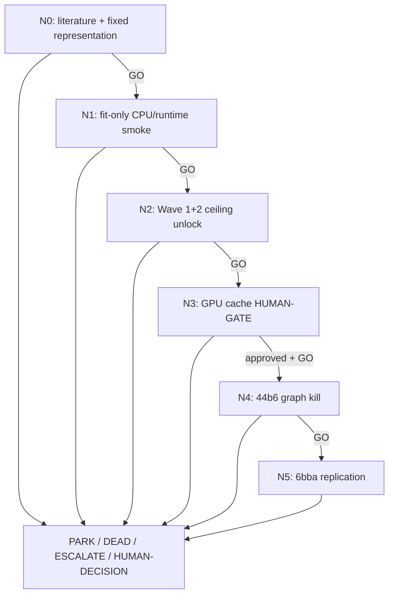

# F0-TRIVIEW-DENSE-TA — dense representation reserve DAG

> Load `../../SHARED_CONTRACT.md`, `../../../LIVE_STATE.md`,
> `../../../top50_seeking_alpha_research_20260727.md`,
> `.agents/skills/seeking-alpha/SKILL.md`, and
> `.agents/skills/dag-prompts/SKILL.md` before dispatching a node.

## Why this DAG exists

F0 is the expensive representation reserve, not Wave-1 default. It tests whether
anisotropy-aware XY/XZ/YZ microscopy embeddings at each 3-D point add identity signal
that the frozen Trackastra cache lacks. Literature supports dense embeddings inside
Trackastra and learned compression of 3-D fluorescence volumes to tractable 2-D
representations; it does **not** directly establish this exact tri-view fusion. The
single-view dense arm is therefore beta, while fixed tri-view fusion is the alpha.
Literature, contract, and CPU feasibility may run concurrently; held extraction stays
locked until Wave 1+2 cannot plausibly reach local `0.925` and a human separately
approves GPU generation.

## Evidence and novelty boundary

- Dense self-supervised/foundation embeddings improved Trackastra linking on two
  datasets; centroid and mean-mask aggregation provide implementation controls
  (MIDL 2026 short paper):
  <https://openreview.net/pdf/2d2323e7e5b7ecc9da47e2e748e46f75876e5d04.pdf>.
- ASCENT learns 3-D fluorescence identity embeddings using a positional,
  projection-based volume compressor (ICCV 2025):
  <https://openaccess.thecvf.com/content/ICCV2025/papers/Han_ASCENT_Annotation-free_Self-supervised_Contrastive_Embeddings_for_3D_Neuron_Tracking_in_ICCV_2025_paper.pdf>.
- Trackastra admits object features through a linear token projection and supplies
  the frozen spatiotemporal association backbone:
  <https://www.ecva.net/papers/eccv_2024/papers_ECCV/papers/09819.pdf>.

The three orthogonal views, point-centered physical crop, and late compact fusion are a
new synthesis, not a literature fact. F0 remains a research bet until it passes its
frozen graph test.

## Node graph

## Node index

| ID | File | Purpose | Exact GO gate |
|---|---|---|---|
| N0 | `N0_literature_contract.md` | Freeze one point-compatible tri-view hypothesis | all evidence claims traceable; four fixed arms; encoder chosen without scorer outcomes |
| N1 | `N1_fitonly_runtime_smoke.md` | Kill identity/runtime failures before GPU | three density quantiles pass identity/repeat; projected full cache `<=30 T4-h`, peak `<=16 GiB` |
| N2 | `N2_wave12_ceiling_gate.md` | Enforce reserve-only sequencing | authenticated Wave-1+2 ceiling `<0.925` with no unresolved cheaper arm reaching it |
| N3 | `N3_gpu_cache_human_gate.md` | Request/execute bounded feature extraction | HUMAN-GATE before launch; authenticated complete cache and exact T4 witness repeat afterward |
| N4 | `N4_44b6_graph_kill.md` | Cheapest objective-level falsifier | tri-view adjusted delta `>=+0.005`, raw/node nonnegative, and strictly beats single-view beta |
| N5 | `N5_6bba_replication.md` | Replicate before global CV57 consideration | same absolute and alpha-attribution gates on 6bba |

## Cascade policy

GO auto-advances except at N3. N3 halts for explicit GPU approval even after analytical
readiness. PARK, DEAD, ESCALATE, and HUMAN-DECISION halt. No Kaggle GPU, submission,
RunPod, paid compute, CV57, push, or external mutation is implied by the branch trigger.

## Standing rules

- Four arms only: frozen Trackastra baseline; fixed XY-only dense beta; fixed
  XY/XZ/YZ tri-view alpha; tri-view with non-XY views deterministically permuted within
  frame as the mechanism ablation. No post-result view/encoder sweep.
- Use physical-unit crops and fixed anisotropy-aware resampling; pin all projection,
  normalization, encoder, compression, and fusion choices before held graphs.
- Encoder weights remain frozen. Only fixed linear compression and a compact
  Trackastra/HOCT-lite fusion head may fit; no full Trackastra or dense-encoder tuning.
- Five observation-distinct grouped fit folds; proposal diagnostics cannot promote.
- 44b6 first. Each family requires adjusted delta `>=+0.005`, raw edge and node-recall
  deltas `>=0`. F0 alpha additionally must strictly beat the XY-only beta on each
  tested family; otherwise the alpha is PARK and the beta may be retained separately.
- No F0 arm reaches CV57 until both family gates pass and the owner separately approves.
- Branch reports propose LEDGER rows; only the root edits `LEDGER.md`.

