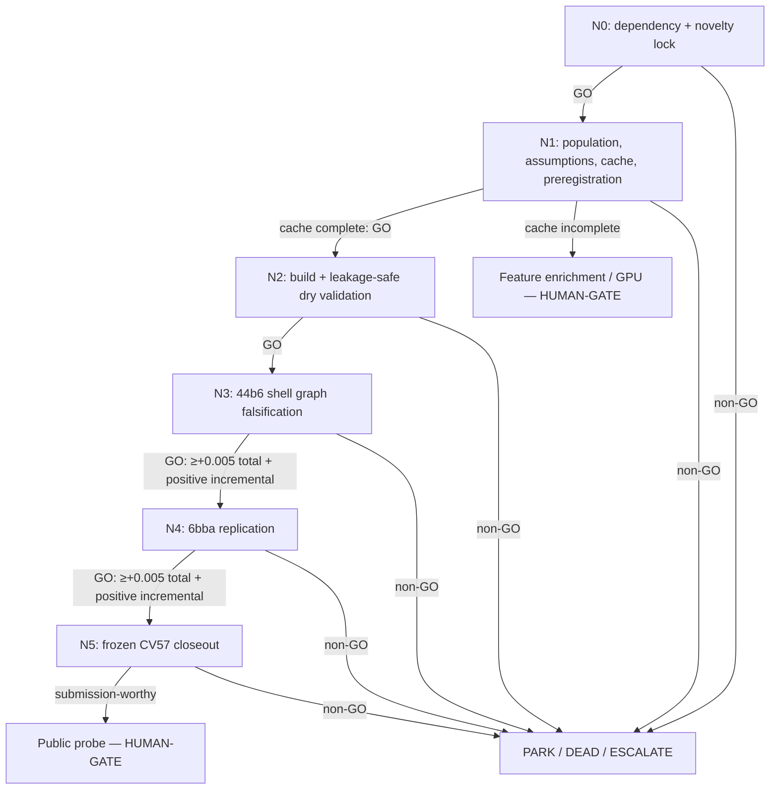

# R0-TA-PU-SHELL — pretrained deployment-PU no-link DAG

> Load `.agents/skills/seeking-alpha/SKILL.md`,
> `.agents/skills/dag-prompts/SKILL.md`, `../../../LIVE_STATE.md`,
> `../../../top50_seeking_alpha_research_20260727.md`,
> `../../../campaign_narrowing_and_hypothesis_dag_v1.md`, and the banked
> `../../../candgen/` abstention reports before dispatch.

## Why this DAG exists

R0 tests whether a **proven pretrained association representation** can safely recover
10–12 µm links from the full unlabeled deployment population with an explicit no-link
model. It is not the DEAD generic shell, frozen-score PU, or conformal-threshold route.
The branch is dependency-locked until a Trackastra or HOCT-lite association arm has
already passed exact adjusted graph delta `>=+0.005` on both 44b6 and 6bba, with raw
edge Jaccard and node recall nonnegative.

The beta controls are exact APNCC, the frozen upstream association winner without shell
expansion, and the **banked** negative `CG1-PU`/`CG1-CRC` results—those negatives are
referenced, not rerun. The alpha is the conjunction of (1) materially stronger
pretrained Trackastra/HOCT representation, (2) exposure to every fit-only unlabeled
deployment candidate rather than GT-visible conflicts, (3) non-negative PU risk, and
(4) preregistered groupwise conformal/FDR admission of explicit link vs no-link. Its
crowding defense is this campaign-specific synthesis across cell tracking, PU learning,
and multiple-risk control; removing any one of the four elements collapses it back to a
banked negative or obvious beta.

Primary basis:

- [Trackastra, ECCV 2024](https://www.ecva.net/papers/eccv_2024/papers_ECCV/papers/09819.pdf)
- [HOCT, arXiv:2607.11754](https://arxiv.org/abs/2607.11754) (2026 preprint)
- [Non-negative PU learning, NeurIPS 2017](https://papers.nips.cc/paper/2017/hash/7cce53cf90577442771720a370c3c723-Abstract.html)
- [Conformal Risk Control, ICLR 2024](https://proceedings.iclr.cc/paper_files/paper/2024/hash/f3549ef9b5ff520a7e41ff3cc306ab2b-Abstract-Conference.html)
- [Benjamini–Yekutieli FDR control under dependency, Annals of Statistics 2001](https://doi.org/10.1214/aos/1013699998)

These sources ground components, not the competition-specific conjunction. Statistical
guarantees must be demonstrated under the actual PU/exchangeability assumptions; if
super-uniform null evidence cannot be justified, the FDR claim is forbidden and R0
PARKs as a research bet.

## Node graph

## Node index

| ID | File | Purpose | Exact advance gate |
|---|---|---|---|
| N0 | `N0_dependency_novelty.md` | Prevent generic PU/shell re-screening | qualifying pretrained association artifact exists |
| N1 | `N1_population_preregistration.md` | Freeze population, assumptions, risk rule, budgets, and cache need | complete fit-only coverage and valid fixed contract |
| N2 | `N2_build_dry_validate.md` | Implement without held graph outcomes | deterministic cross-fit, PU/risk-control tests pass |
| N3 | `N3_44b6_graph_falsification.md` | Hard-family local kill | total adjusted `>=+0.005`; positive incremental shell; raw/node/cap pass |
| N4 | `N4_6bba_replication.md` | Cross-family replication | same total/incremental/raw/node/cap gates |
| N5 | `N5_cv57_closeout.md` | Once-frozen local confirmation | observation-distinct; total and incremental positive; no regression |

## Cascade policy

- Dispatch N0. A **GO** proceeds directly to the next node in the same run.
- PARK / DEAD / ESCALATE / HUMAN-DECISION halt immediately and report.
- Running all six portfolio roots concurrently does not waive R0's N0 dependency. In
  the current frontier, R0 should PARK cleanly until the upstream artifact exists.
- N1 is a **HUMAN-GATE** whenever full-population representation coverage requires a
  Kaggle GPU, RunPod, paid compute, upload, push, or outward mutation. It writes a
  manifest and returns HUMAN-DECISION before launch.
- N3 is 44b6-first. A non-GO forbids N4/N5. N5 never crosses the Kaggle-submission
  HUMAN-GATE.
- This folder is a preregistered foundation. Merely creating it authorizes no run.

## Standing rules

- Fit-only until N5; labels from validation/test/CV57 never enter feature choice,
  class-prior estimation, calibration, grouping, thresholding, or arm selection.
- The unlabeled pool stays unlabeled. Never relabel it negative.
- Proposal metrics and PU training risk are diagnostic. Only exact frozen-scorer graph
  deltas promote.
- No geometry/NCC/constant-velocity-only shell rule, scalar-only threshold repair,
  adaptive grid, graph-cost sweep, GNN, or from-scratch representation.
- Exact per-family CG0 false-admission budgets and the existing per-video acceptance cap
  are hard gates, not tunable targets.
- Each node writes a report plus a **proposed** LEDGER row and updates
  `../../../LIVE_STATE.md` after an actual result or gate change. Only the root
  coordinator may edit `../../../LEDGER.md`.
