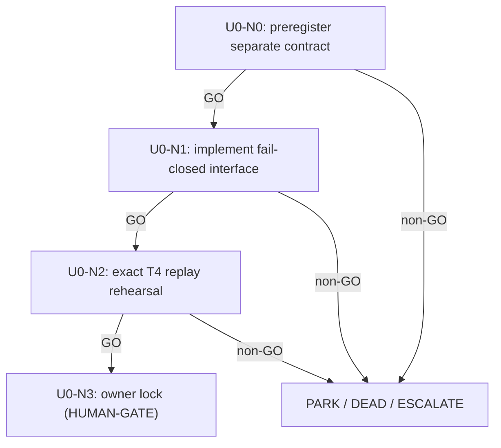

# U0-T4CANON — T4-native evidence-governance cascade

> Load `../../../LIVE_STATE.md`,
> `../../../campaign_narrowing_and_hypothesis_dag_v1.md`,
> `../../../top50_seeking_alpha_research_20260727.md`,
> `.agents/skills/seeking-alpha/SKILL.md`, and
> `.agents/skills/dag-prompts/SKILL.md`. Old `H1-ZWRFEAT` N1 remains DEAD.

## Why this DAG exists

The authenticated T4 cache is complete and repeatable, but the old M5↔T4 parity
contract failed structurally before any graph score. U0 asks a different, computable
question: can a new production-device-native contract make all fitting, routing, and
evaluation functions of the authenticated T4 domain alone, with exact replay and no
validation leakage? U0 is a necessary **beta/governance enabler**, not model alpha and
not evidence that the old drift was benign.

## Node graph

## Node index

| ID | File | Purpose | Exact advance gate |
|---|---|---|---|
| U0-N0 | `N0_preregister_contract.md` | Freeze a genuinely separate T4-native hypothesis | all 12 invariants explicit; old N1 still DEAD; M5 cannot affect a decision |
| U0-N1 | `N1_implement_interface.md` | Build the contract/guard/test surface without scoring | all focused tests pass; forbidden paths and M5 decision inputs fail closed |
| U0-N2 | `N2_exact_replay_rehearsal.md` | Falsify T4 nondeterminism before graph evaluation | two isolated T4-native fit/rebuild replays are byte-identical |
| U0-N3 | `N3_human_lock.md` | Ask the owner to lock or reject the new mechanism | analytical dossier complete; always halt for `HUMAN-DECISION` |

## Cascade policy

- GO auto-advances from U0-N0 through U0-N2.
- U0-N3 is a **HUMAN-GATE**. Even a complete dossier halts; only the owner may
  lock the new contract and open downstream graph experiments.
- PARK / DEAD / ESCALATE / HUMAN-DECISION halt. No Kaggle action, GPU, RunPod,
  CV57, graph score, submission, or public claim occurs in this DAG.

## Standing rules and evidence

- Root coordinator alone edits `../../../LEDGER.md`; each node returns one proposed
  row. A node result updates `../../../LIVE_STATE.md`.
- The new contract is production-device-native: all fit/calibration/evaluation inputs
  are authenticated T4 arrays. M5 witnesses are diagnostics only.
- Challenger IDs, conflict membership, offsets, split identity, scorer identity, and
  APNCC control remain exact and immutable. No tolerance is widened.
- Frozen Trackastra is the beta representation described in Gallusser & Weigert,
  ECCV 2024 ([primary paper](https://www.ecva.net/papers/eccv_2024/papers_ECCV/papers/09819.pdf)).
  U0 makes no novelty claim; its value is a falsifiable domain-pinning contract.

